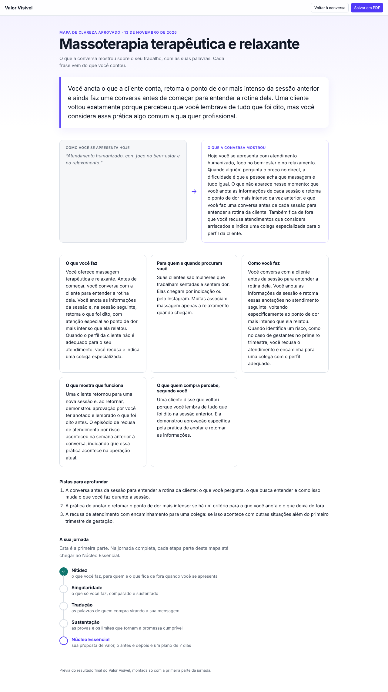
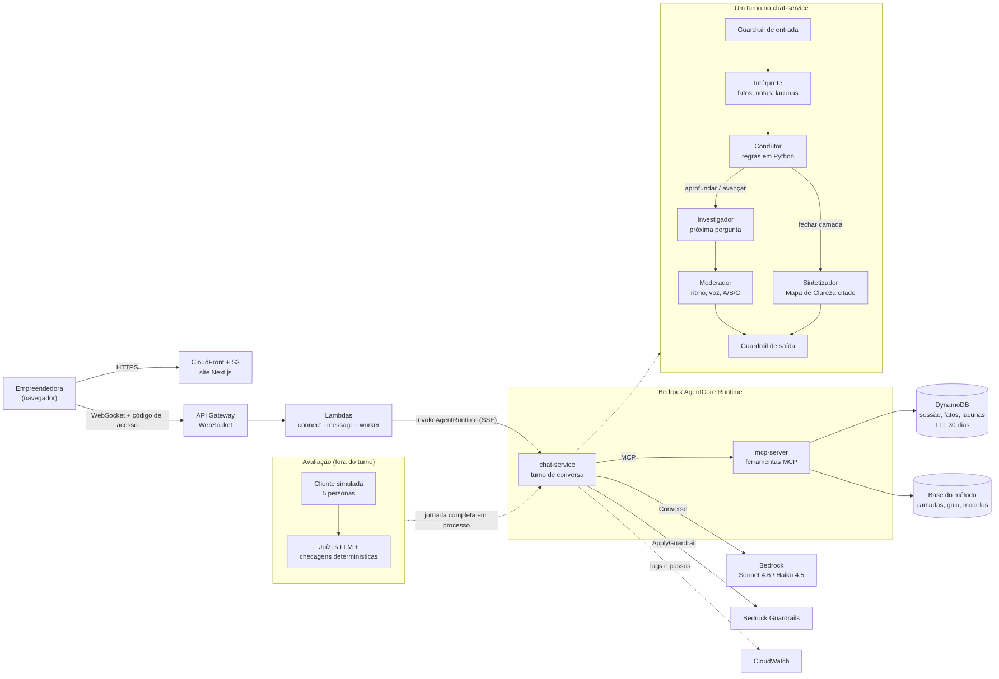

# Valor Visível

**Quem empreende sozinho sabe fazer, mas não sabe dizer o que faz de diferente.** Na hora de explicar
por que alguém deveria escolher o seu trabalho, a resposta vira "qualidade", "atendimento
humanizado" ou o preço, as mesmas palavras de qualquer concorrente.

O Valor Visível é uma conversa guiada por agentes de IA que investiga a rotina do negócio,
separa o que é fato do que é suposição e devolve, com as palavras da própria pessoa, o que ela faz
e ainda não conta. Cada frase do resultado aponta para algo que ela disse na conversa.

Projeto do hackathon **AKCIT Camp, regional Nordeste** (Recife, 13/11/2026).

> [!IMPORTANT]
> **Aviso: esta é a versão aberta do código, sem o conteúdo proprietário.**
>
> A arquitetura, os agentes, as proteções, a avaliação e a interface são os mesmos da versão usada
> na demo. O método do Valor Visível é proprietário e **foi omitido deste repositório**:
>
> - o modelo de leitura do negócio usado pela especialista, seus guias de aplicação e o guia de voz;
> - as perguntas-base, os critérios de cada camada e os modelos de síntese originais;
> - os prompts de condução da especialista e o motor original que deu origem ao projeto;
> - documentos internos de planejamento, backlog e implantação.
>
> No lugar, há um **método de exemplo** com perguntas e modelos genéricos para as quatro camadas,
> suficiente para rodar a jornada de ponta a ponta. Por isso as conversas desta versão são mais
> simples que as da demo, e os números de avaliação abaixo se referem à versão completa.

Demo: [vv.lirano.com.br](https://vv.lirano.com.br) (código de acesso com a equipe) ·
sessão gravada, sem código: [vv.lirano.com.br/?replay=demo](https://vv.lirano.com.br/?replay=demo)

---

## Parte 1 · Para todo mundo

### Para quem

A persona da demo é uma **massoterapeuta autônoma**. Ela atende bem e tem clientes fiéis, mas,
quando alguém pergunta o preço pelo Instagram, responde com duração, valor e "atendimento
humanizado", e a pessoa compara com qualquer outra massagem. O que ela faz de diferente existe, só
não aparece: a conversa antes da sessão, o que ela anota e retoma na sessão seguinte, o
atendimento que ela recusa por segurança.

### Como funciona, em 4 passos

1. **Ela conta sobre o negócio** em poucas escolhas rápidas e escreve, numa frase, como se apresenta
   hoje. Essa frase fica guardada sem correção, para comparar no fim.
2. **A conversa começa pela dificuldade que ela mesma apontou** e pede episódios reais ("a última
   vez que isso aconteceu"), não opiniões. Quando a resposta é vaga, o sistema aprofunda; quando ela
   trava, oferece duas leituras do que ela já disse e uma opção livre.
3. **Ela recebe o Mapa de Clareza**: o que faz, para quem, como faz, o que os clientes percebem e o
   que fica de fora quando ela se apresenta.
4. **Ela confere e aprova, ou corrige.** O sistema só segue com o mapa aprovado por ela. Depois da
   aprovação, a página de resultado mostra o antes e depois.



<sub>Página de resultado gerada a partir de uma conversa simulada com a persona da demo.</sub>

### O que muda em relação às alternativas

| Alternativa | O que entrega | O que falta |
| --- | --- | --- |
| Perguntar a um chat de IA genérico | Gera textos rapidamente | Trabalha com o que recebe; sem investigar a rotina, tende a respostas que serviriam para qualquer negócio |
| Consultoria ou mentoria de marca | Profundidade e acompanhamento | Custo e prazo nem sempre compatíveis com quem trabalha por conta própria |
| Fazer por conta própria | Conhece o próprio negócio | Tende a tratar como "normal" o que pode diferenciá-la |
| **Valor Visível** | Investigação guiada, com o resultado ligado ao que ela disse | Hoje cobre a primeira de quatro etapas (abaixo) |

### O que está pronto

| | |
| --- | --- |
| **Funcionando na nuvem** | Cadastro inicial com consentimento, a primeira etapa completa (Nitidez) até o Mapa de Clareza, revisão obrigatória do mapa e página de resultado. Filtros de segurança no que ela escreve e no que o sistema responde, código de acesso e dados apagados em 30 dias. |
| **Funcionando para a equipe** | Simulação automática de conversas com cinco perfis de cliente, avaliação de qualidade por IA e por regras, custo por conversa e sessão gravada para a demo. |
| **Próximas etapas** | Singularidade (o que só ela faz), Tradução (a mensagem), Sustentação (as provas) e o Núcleo Essencial, com a proposta de valor, o antes e depois e um plano de 7 dias. |

### Quanto custa e como se paga

Cada conversa da primeira etapa custa entre **US$ 0,36 e US$ 0,45** de nuvem, medido nas simulações.
A jornada completa está projetada em **cerca de R$ 21** com a configuração atual e **R$ 10** com as
otimizações planejadas. Num preço de referência de R$ 97 por diagnóstico, ainda em validação, a
margem bruta sobre a nuvem ficaria entre 78% e 89%. Detalhes e premissas em [viabilidade econômica](docs/source/viabilidade.md).

### Qualidade, medida

Cada mudança passa por uma bateria de conversas simuladas, avaliadas por um segundo modelo de IA
com critérios definidos pela especialista do método e por checagens automáticas. Os números abaixo
são da versão usada na demo, com o método completo. Na última
rodada (12/11, três perfis):

| O que medimos | Resultado | Meta |
| --- | --- | --- |
| A conversa chegou ao mapa | 3 de 3 | todas |
| Frases do mapa que apontam para algo que ela disse | 100% | 100% |
| Suposição apresentada como fato | nenhuma | nenhuma |
| Perguntas repetidas | nenhuma | nenhuma |
| O sistema reconhece o que ela trouxe antes de perguntar (nota de 1 a 5) | 3,5 a 4,2 | 4 ou mais |
| Tom de conversa profissional e natural (nota de 1 a 5) | 4,0 a 4,3 | 4 ou mais |
| Uma única pergunta por mensagem | entre 1 de 4 e 3 de 4 mensagens | quase todas (corrigido depois dessa rodada, ainda sem nova medição) |

### Equipe

- **Líder do projeto**: método, negócio e pitch.
- **Ricardo Lira**: responsável técnico, arquitetura, agentes e infraestrutura.

### Termos usados

- **Nitidez, Singularidade, Tradução, Sustentação**: as quatro etapas da jornada, nessa ordem.
- **Mapa de Clareza**: o resultado da primeira etapa.
- **Núcleo Essencial**: o resultado final da jornada completa.
- **Linha de base**: a frase com que ela se apresenta antes de começar, guardada para comparar.
- **Agente**: um modelo de IA com uma tarefa e regras próprias. Aqui são quatro, mais regras fixas em código.

---

## Parte 2 · Para quem é técnico



<sub>Fonte do diagrama: [docs/architecture/architecture.mmd](docs/architecture/architecture.mmd). Também disponível no [Canva](https://canva.link/bm1o62lz8byeeq7).</sub>

### Um turno, passo a passo

**Entrada:** a mensagem dela, o estado da sessão (etapa, fatos e lacunas já registrados) e o perfil
do negócio dado no onboarding.

1. **Proteção de entrada** ([guardrails.py](chat-service/src/vv_chat/guardrails.py)): Bedrock
   Guardrails mascara dados pessoais e bloqueia conteúdo fora da política.
2. **Intérprete** ([interpreter.py](chat-service/src/vv_chat/agents/interpreter.py)): dá notas de
   concretude, relevância, sustentação e aderência à resposta e extrai fatos **com o trecho literal**
   dela, classificados pela origem (fala dela, relato de cliente, site, inferência).
3. **Condutor** ([conductor/rules.py](chat-service/src/vv_chat/conductor/rules.py)): regras em Python,
   sem modelo, decidem aprofundar, avançar, retomar uma lacuna ou fechar a etapa
   ([conductor.yaml](chat-service/config/conductor.yaml)).
4. **Investigador** ([investigator.py](chat-service/src/vv_chat/agents/investigator.py)): escreve a
   próxima pergunta, ancorada num episódio concreto e no que ainda falta, sem sugerir a resposta.
5. **Moderador** ([moderator.py](chat-service/src/vv_chat/agents/moderator.py)): reconhece o que ela
   trouxe, mostra a lacuna e faz uma única pergunta; quando ela trava, oferece opções A e B feitas só
   de fatos que ela já deu. Travas em código: uma pergunta por mensagem e opções sem fundamento
   descartadas.
6. **Sintetizador** ([synthesizer.py](chat-service/src/vv_chat/agents/synthesizer.py)), quando o
   Condutor fecha a etapa: monta o mapa; toda frase termina com a referência do fato que a sustenta,
   e frase sem referência é removida em código.
7. **Proteção de saída**, gravação pelo servidor de ferramentas (MCP) e envio em tempo real pelo
   WebSocket.

**Saída:** uma mensagem com uma pergunta (e opções, quando cabem) ou o mapa, que fica aguardando
aprovação ([flows/review.py](chat-service/src/vv_chat/flows/review.py)).

| Agente | Recebe | Entrega | Modelo |
| --- | --- | --- | --- |
| Intérprete | resposta, etapa, guia de classificação | notas, fatos com trecho literal, lacunas | Claude Sonnet 4.6 |
| Condutor | notas, fatos, lacunas, tentativas | decisão e modo da conversa | regras em Python |
| Investigador | decisão, fatos, perfil do negócio, perguntas-base da etapa | rascunho da pergunta | Claude Sonnet 4.6 |
| Moderador | rascunho, modo, fatos, resposta dela | mensagem final, opções A/B/C | Claude Sonnet 4.6 |
| Sintetizador | fatos, lacunas, perfil, modelo do mapa, correção dela | mapa com referências | Claude Sonnet 4.6 |

### Perguntas da banca (seção 10 do edital)

**De onde vêm os fatos e como evitamos informação inventada?**
*Todo fato é uma frase dela, guardada palavra por palavra.* O Intérprete descarta fato sem trecho
literal ([contrato `ExtractedFact`](packages/vv-contracts/src/vv_contracts/agents.py)). O conteúdo
do método vem de uma base de conhecimento (nesta versão, um exemplo), servida por ferramentas MCP
([mcp-server/tools](mcp-server/src/vv_mcp/tools)). O mapa só aceita frases que citam um fato
existente, e uma checagem automática nas simulações verifica se alguma suposição aparece como fato
([fidelity.py](integration-tests/src/vv_it/fidelity.py)).

**Como a saída do modelo é conduzida?**
*Cada agente tem uma tarefa só e responde num formato fixo.* Prompts por agente sobre uma base comum
([prompts/](chat-service/prompts)), saída estruturada validada (Pydantic) e, se a saída vier
inválida, um caminho alternativo sem IA, em vez de um erro na tela. Os agentes são instruídos a
tratar o que ela escreve como dado, e não como instrução.

**Como o agente decide acionar uma ferramenta e o que acontece quando nenhuma serve?**
*Quem decide o próximo passo são regras em código, não o modelo.* Cada passo chama as ferramentas
MCP de que precisa (`save_fact`, `list_gaps`, `get_layer_spec`…) pelo
[ToolGateway](chat-service/src/vv_chat/gateway/mcp.py). Sem pergunta adequada no banco, o
Investigador cria uma; se falhar, usa uma pergunta de reserva. Se a etapa seguinte ainda não existe,
a sessão fica no mapa aprovado em vez de inventar conteúdo.

**Quais são as etapas, o que cada uma recebe e entrega, e onde fica o estado?**
*Ver o passo a passo acima.* O estado (sessão, turnos, fatos, lacunas, mapas, revisões) fica no
DynamoDB e só o servidor MCP o acessa.

**Por que vários agentes e não um só? Quem consolida?**
*Porque, num prompt único, os erros apareciam juntos e eram difíceis de corrigir.* O modelo
elogiava, induzia a resposta e repetia perguntas. Separados, cada um tem contrato e avaliação próprios, e a decisão de avançar saiu do
modelo para regras testáveis (100% de cobertura no Condutor). O Condutor resolve conflitos, o
Sintetizador consolida a etapa e ela aprova o resultado.

**O que acontece com entrada inesperada ou falha? Como medimos qualidade?**
*Tudo o que ela escreve e recebe passa por filtros de segurança, e cada agente tem um plano B.* Fora do tema, o Moderador
traz de volta; resposta vaga ou "não sei", muda o modo e oferece opções; falha de modelo, caminho
alternativo por agente. Bedrock Guardrails na entrada e na saída; código de acesso e limite de
mensagens no WebSocket ([connection.py](backend/src/vv_backend/connection.py)). Qualidade:
[simulação](integration-tests/AGENTS.md) com cinco perfis e metas em
[thresholds.yaml](integration-tests/config/thresholds.yaml).

**O que o agente lembra e por quanto tempo?**
*Só a conversa atual, e por 30 dias.* Nada passa de uma sessão para outra; consentimento antes de
começar; dados pessoais mascarados; expiração automática no DynamoDB
([repo_dynamo.py](mcp-server/src/vv_mcp/repo_dynamo.py)).

**Como investigaríamos uma resposta ruim e que métrica indicaria piora?**
*Cada turno registra o que cada agente decidiu, e a conversa pode ser reproduzida.* A sessão pode
ser exportada com fatos e decisões ([export_session.py](scripts/export_session.py)) e rodada de novo
no terminal mostrando o raciocínio de cada agente (`scripts/try_turn.py`). Piora aparece primeiro
em "uma pergunta por mensagem", "pergunta que induz a resposta" e "frases com referência", e nos
caminhos alternativos e no custo por conversa.

### Rodar

**Localmente, com credenciais da AWS** (Bedrock com Claude Sonnet 4.6 e Haiku 4.5 habilitados, região
`us-east-1`; estado em memória, sem criar nada na conta):

```bash
make setup                  # uv (Python 3.12) e dependências
make demo-local             # agentes + WebSocket em ws://localhost:8765
cd frontend && npm install && NEXT_PUBLIC_WS_URL=ws://localhost:8765 npm run dev
# abrir http://localhost:3000
```

Sem AWS: `make check` roda lint, tipos e 600+ testes com modelos falsos;
`cd frontend && NEXT_PUBLIC_WS_MOCK=1 npm run dev` abre a interface com um servidor simulado.

**Na nuvem:** deploy com CDK (`infra/`) ou pelo workflow manual `deploy` do GitHub Actions, que
assume um papel IAM por OIDC (variáveis descritas no próprio workflow). Sessão gravada:
`scripts/export_session.py --replay` e `/?replay=<nome>` (`&speed=3` acelera).

### Custo e operação

US$ 0,085 por turno com todos os agentes no Claude Sonnet 4.6; a conta completa está em
[cost_model.py](scripts/cost_model.py). Teste de fumaça do ambiente publicado:
[smoke.py](scripts/smoke.py).
